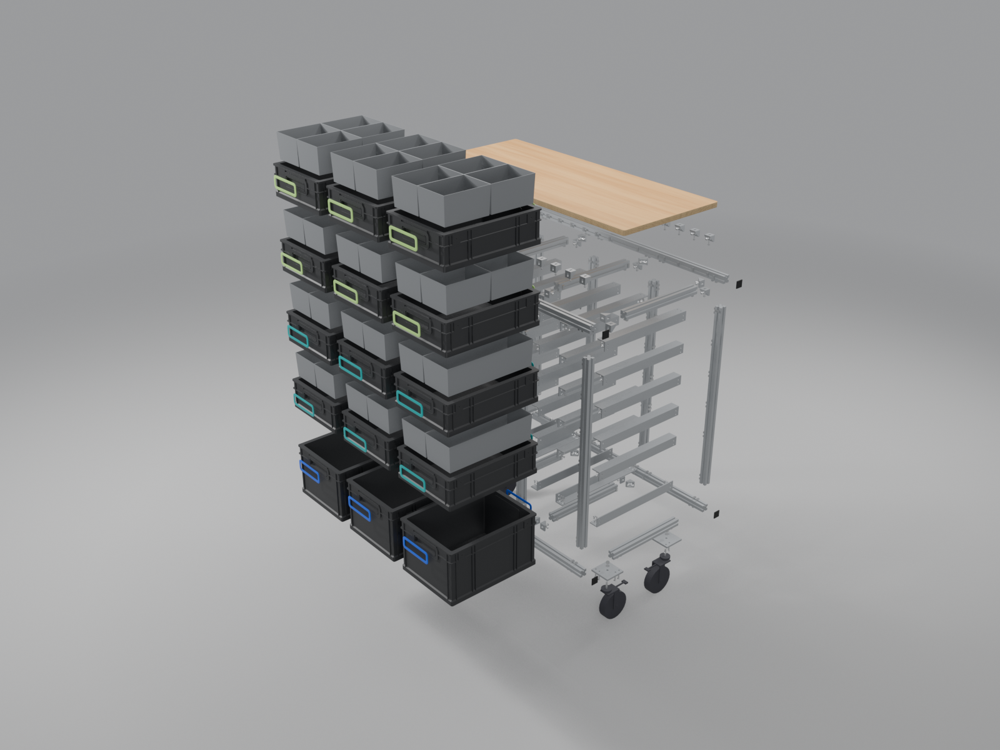

# lego_eurobox_rack

A rolling rack of 30 × 30 aluminium profiles that holds 15 Euroboxes NextGen
2.0 Cycle 400 × 300 from ab-in-die-BOX as LEGO drawers: 3 columns, one level of
220 mm boxes at the bottom and four levels of 120 mm boxes with inserts above.
One long bar runs over all three columns front and back, top and bottom; the
rack stands on 4 swivel castors with total lock, each under an aluminium
plate at a corner, and has no panels. No profile is drilled or machined: the
angles under the lowest and above the top boxes hold the uprights to the bars.
The back is open: every box pulls out to the front and to the back, so the
rack stands free in the room. Frame 1074 × 435 × 1025 mm under a structural
21 mm birch plywood top plate, 1114 × 483 mm, its top at 1046 mm. Every metal
part and the castors come from motedis in one order.

**[Open the 3D viewer](https://countzero.github.io/lego_eurobox_rack/)**: turn
the rack, pull the boxes out, draw it apart, pick the ColorClip colours.




> [!WARNING]
> Not ready to build. The box geometry is provisional until the boxes are
> measured (roadmap 0004). The [roadmap](docs/roadmap.md) says what is planned
> and how far each step has got.

## Front view

Heights in mm, not to scale. One bar runs across all three columns at the top
and at the bottom; the top plate (21 mm, top at 1046) is screwed to the top
bars from below and stiffens them. Each box stands on a 40 × 40 × 4 angle, whose
hanging leg guides the rim of the box below and keeps it from tipping when it
is pulled out. The castors (125 mm wheels, 160 high, 100 kg each, total
lock) sit under 8 mm castor plates at the corners.

```
        |<------------------------------ 1074 frame ------------------------------->|
 1025 - =============================================================================  top bar
  991 - ||#####             #####||#####             #####||#####             #####||
        ||  +-----------------+  ||  +-----------------+  ||  +-----------------+  ||
        ||  | 120, 1/4        |  ||  | 120, 1/4        |  ||  | 120, 1/4        |  ||   L5
  858 - ||##+-----------------+##||##+-----------------+##||##+-----------------+##||
        ||  +-----------------+  ||  +-----------------+  ||  +-----------------+  ||
        ||  | 120, 1/4        |  ||  | 120, 1/4        |  ||  | 120, 1/4        |  ||   L4
  721 - ||##+-----------------+##||##+-----------------+##||##+-----------------+##||
        ||  +-----------------+  ||  +-----------------+  ||  +-----------------+  ||
        ||  | 120, 1/2        |  ||  | 120, 1/2        |  ||  | 120, 1/2        |  ||   L3
  584 - ||##+-----------------+##||##+-----------------+##||##+-----------------+##||
        ||  +-----------------+  ||  +-----------------+  ||  +-----------------+  ||
        ||  | 120, 1/2        |  ||  | 120, 1/2        |  ||  | 120, 1/2        |  ||   L2
  447 - ||##+-----------------+##||##+-----------------+##||##+-----------------+##||
        ||  +-----------------+  ||  +-----------------+  ||  +-----------------+  ||
        ||  | 220             |  ||  | 220             |  ||  | 220             |  ||   L1
        ||  |                 |  ||  |                 |  ||  |                 |  ||
        ||  |                 |  ||  |                 |  ||  |                 |  ||
  202 - ||L_+-----------------+_J||L_+-----------------+_J||L_+-----------------+_J||
  198 - =============================================================================  bottom bar
  168 - =============================================================================
  160 - [==]                                                                     [==]  castor plates
       (O)                                                                        (O)  braked castors
    0 - =============================================================================
        30<----- 318 clear ----->30<----- 318 clear ----->30<----- 318 clear ----->30
```

## Repository

| Path                  | What                                                       |
| --------------------- | ---------------------------------------------------------- |
| `design/rack.json`    | Every dimension and the part catalog: the single source    |
| `docs/design.md`      | Decisions, fit check, drawings, joints and contracts       |
| `docs/inserts.md`     | The inserts of the 120 mm boxes                            |
| `docs/prices.md`      | Prices of every part, the orders and the totals            |
| `docs/assembly.md`    | The build, step by step                                    |
| `bom/`                | Parts list and cut list, generated from `rack.json`        |
| `blender/`            | The model, built headless from `rack.json`, and its export |
| `renders/`            | Renders of the model                                       |
| `web/`                | The 3D viewer, published on GitHub Pages                   |
| `docs/roadmap.md`     | The steps, their specifications and their status           |
| `docs/sources.md`     | Every fact with its status and source                      |
| `docs/conventions.md` | Branches, commits, pull requests, how facts are cited      |
| `docs/releases.md`    | How a release is cut and published                         |
| `docs/worktrees.md`   | How parallel steps use git worktrees                       |
| `docs/web_viewer.md`  | How the viewer is built                                    |

## License

[MIT](LICENSE)
