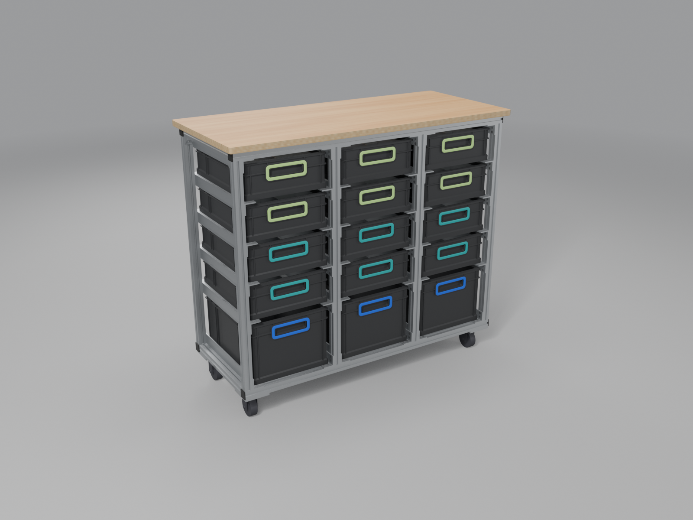
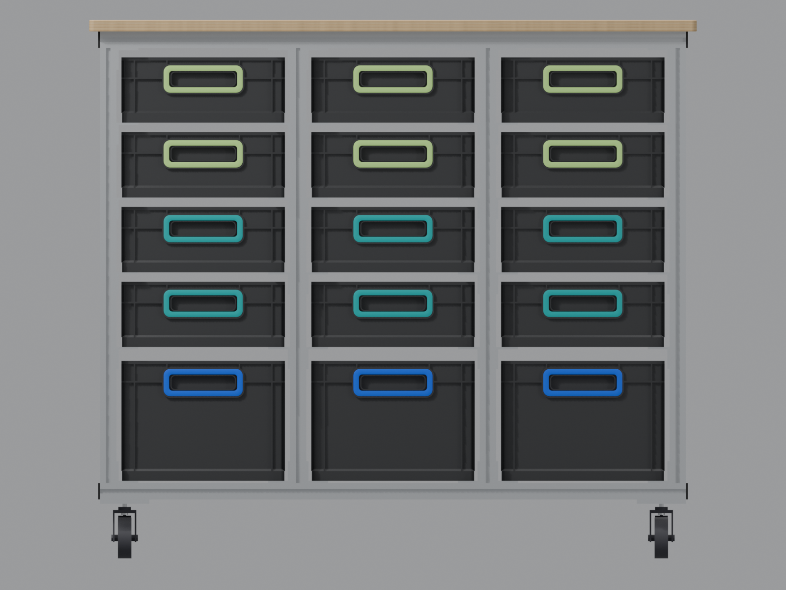
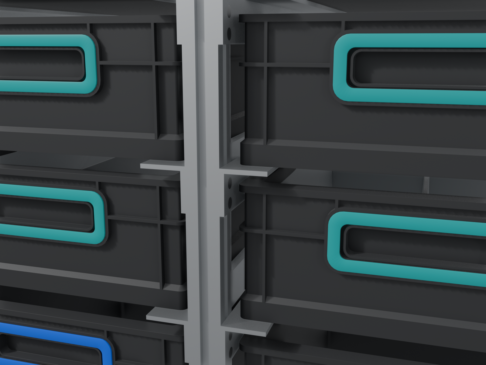
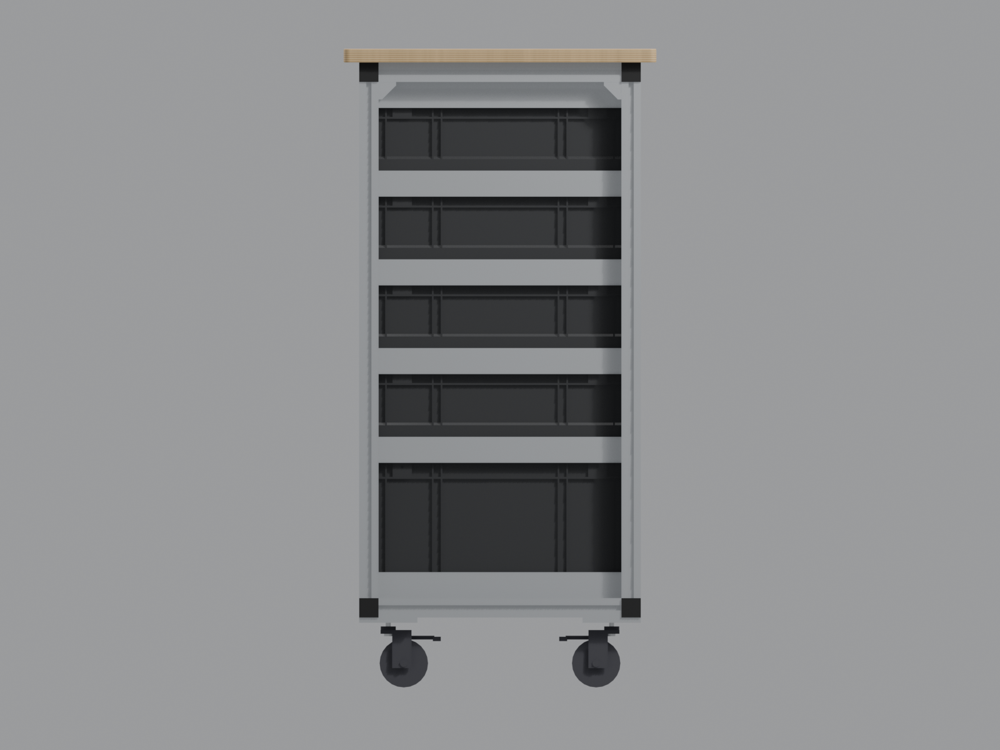
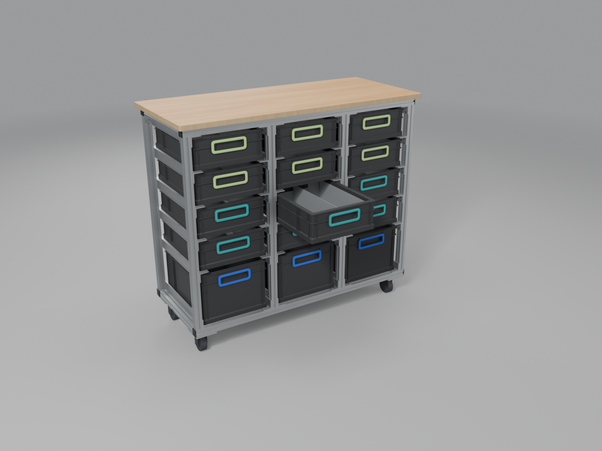
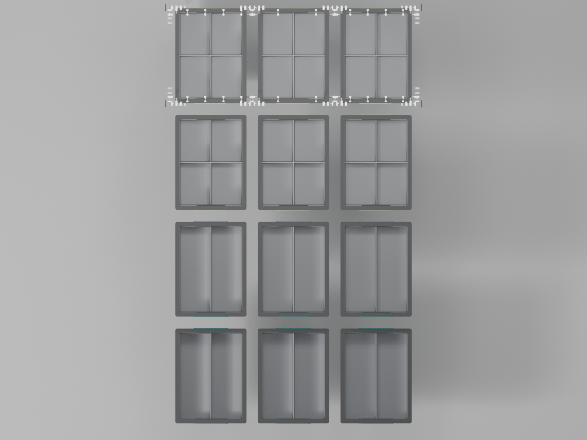

# Assembly

How one person builds the rack. Every number is a copy of `design/rack.json`,
which wins where the two differ, and is provisional until the boxes are
measured (roadmap 0004). Parts are named by their ID from `design.md` →
*Contracts*; `x`, `y` and `z` are the rack's coordinates (`x` to the right,
`y` to the back, `z` up, origin on the floor at the front-left frame
corner). Columns count 1-3 from the left seen from the
front, levels 1-5 from the bottom.

The renders show the top plate on the frame. It is part of the structure and
is fitted before the rack is loaded (step 9).

The rack has a front (`y` 0-30) and a back (`y` 405-435) row, each a bottom
bar, a top bar and four uprights. Nothing is drilled in any profile: each
upright end stands against its bar and is held by the angle beside it, which
works as a bracket (`angle.base` at the bottom, `angle.guard` at the top) and
runs the full depth, so it also ties the front row to the back row. Eight
depth beams and a structural top plate complete the frame. It stands on four
braked castors under castor plates at the corners and holds 15 Eurobox
NextGen 2.0 Cycle 400 × 300, short side with the handle at the front:
3 × 220 on level 1 and 12 × 120 on levels 2-5. The back is open: a box comes
out at the front and at the back. Every metal part and the castors come from
motedis in one order (`docs/prices.md`).

## Before you start

### Parts

| Part ID                   | Quantity | Used in step |
| ------------------------- | -------- | ------------ |
| `profile.bar_top`         | 2        | 5            |
| `profile.bar_bottom`      | 2        | 5            |
| `profile.upright`         | 8        | 1, 5         |
| `profile.beam_depth`      | 8        | 5            |
| `angle.base`              | 6        | 2, 5         |
| `angle.support`           | 24       | 2, 7         |
| `angle.guard`             | 6        | 2, 5         |
| `plate.castor`            | 4        | 3, 6         |
| `tnut.m5`                 | 192      | 4, 5, 7      |
| `tnut.m6`                 | 84       | 4, 5, 6, 9   |
| `bracket.inside_30`       | 24       | 5            |
| `screw.m6x12_button`      | 68       | 5, 9         |
| `screw.m6x16_countersunk` | 16       | 6            |
| `castor.brake_75`         | 4        | 6            |
| `screw.m8x35_socket`      | 4        | 6            |
| `washer.m8`               | 8        | 6            |
| `nut.m8_lock`             | 4        | 6            |
| `screw.m5x12_countersunk` | 192      | 5, 7         |
| `cap.end_30`              | 8        | 8            |
| `plate.top`               | 1        | 9            |
| `bracket.plate`           | 20       | 9            |
| `screw.wood_4_5x16`       | 20       | 9            |
| `box.e220`                | 3        | 10           |
| `box.e120`                | 12       | 10           |
| `clip.blue`               | 3        | 10           |
| `clip.turquoise`          | 6        | 10           |
| `clip.lightgreen`         | 6        | 10           |
| `insert.set_quarter`      | 6        | 10           |
| `insert.set_half`         | 6        | 10           |

Buy about ten spare `tnut.m5` and `tnut.m6`. Both are hammer nuts for B-type
slot 8: they go into a slot from its open face, also where the slot is closed
at both ends, and turn 90° as the screw is tightened ([motedis][mo-hm],
[BM Profiles][bm-nuts]). So no nut has to be threaded in before a joint is
made, and a forgotten one is added later without taking the frame apart.

### Order pre-machined

- Profiles cut to size by motedis, one piece each: 8 × 797
  (`profile.upright`), 4 × 1074 (`profile.bar_top`, `profile.bar_bottom`),
  8 × 375 (`profile.beam_depth`), all 30 × 30 B-type slot 8
  ([motedis 30x30][mo-30]). The cut list is `bom/cutlist.csv`. Cut to size
  only, no machining or holes.
- Angles 40 × 40 × 4, anodised ([motedis angle][mo-angle]): 9 bars of
  1980 mm, cut by motedis to 4 × 435 each ("Zuschnitt ganzer Stab"),
  36 pieces: 6 `angle.base`, 24 `angle.support`, 6 `angle.guard`. Their holes
  are drilled at home (step 2).
- Castor plates: motedis Aluminium Plättchen 8 × 90, EN AW-5083, one 740 mm
  bar cut to 4 × 90 ([motedis plate][mo-plate]), 4 pieces of 90 × 90 × 8. Their
  holes are drilled at home (step 3).
- Top plate: 21 mm birch plywood cut to 1114 × 483, grain along the 1114
  length (`docs/prices.md`); its corners are rounded at home (step 9).

### Tools

| Tool                                     | For                                                        |
| ---------------------------------------- | ---------------------------------------------------------- |
| Hex keys 3, 4, 5 and 6 mm (or bits)      | M5 and M6 countersunk, M6 button and M8 socket screws      |
| Small torque screwdriver, about 3 N·m    | The M5 angle screws (`UNVERIFIED` value; or a gentle hand) |
| 13 mm spanner(s)                         | The castors' lock nuts                                     |
| Hand drill, 5.5 mm HSS bit               | Clearance holes in the angles                              |
| 6.6 mm HSS bit                           | Clearance holes for M6 in the castor plates                |
| 9 mm HSS bit                             | Castor bolt hole in the castor plates                      |
| 90° countersink bit, at least 13 mm      | Countersinking the angles and the castor plates            |
| Deburring tool or fine file              | Cut ends and drilled holes                                 |
| Steel square, tape measure, steel rule   | Marking and squaring                                       |
| Fine marker, centre punch                | Marking heights and holes                                  |
| Spirit level, at least 600 mm            | Levels horizontal, uprights plumb                          |
| Clamps, a few wooden blocks              | Holding the frame square while the angles are fitted       |
| Drill, 2.5 mm wood bit with a depth stop | Pilot holes in the top plate, at most 14 mm deep           |
| Jigsaw or rasp, sandpaper                | R10 corners and round edges of the top plate               |

Work on a flat, clean floor with a blanket or cardboard under the profiles.

### Deburr

Deburr every cut end of profiles, angles and plates, and both sides of every
drilled hole. A burr on a hanging leg catches the rim of a box; a burr on a
profile end keeps the joint from closing.

## Step 1: Mark the uprights

**Parts:** `profile.upright` × 8.

1. Check that each upright is 797 long with square ends. Either end can be the
   bottom (`z` 138); the other is the top (`z` 935).
2. Name the uprights by position: front row `F0`, `F1`, `F2`, `F3` at `x` 0,
   348, 696, 1044 (left edge of the profile), back row `B0` to `B3` at the same
   `x`, `y` 405. Write the name on a piece of tape at the top end.
3. Measured from the bottom end (`z` 138 on the rack is 0 on the upright), mark
   on each face that carries angles (the inner `x` faces; `F1`, `F2`, `B1`,
   `B2` have two) the flat leg of each angle:

| Angle           | Level | Flat leg | Fixing leg on the upright | Mark on the upright (from bottom end) |
| --------------- | ----- | -------- | ------------------------- | ------------------------------------- |
| `angle.base`    | 1     | 138-142  | 138-178, leg up           | 0 (underside of flat leg, on the bar) |
| `angle.support` | 2     | 383-387  | 347-387, leg down         | 249 (top of flat leg)                 |
| `angle.support` | 3     | 520-524  | 484-524, leg down         | 386 (top of flat leg)                 |
| `angle.support` | 4     | 657-661  | 621-661, leg down         | 523 (top of flat leg)                 |
| `angle.support` | 5     | 794-798  | 758-798, leg down         | 660 (top of flat leg)                 |
| `angle.guard`   | guard | 931-935  | 895-935, leg down         | 797 (top end, under the top bar)      |

The `z` of a mark is the mark plus 138.

**Check:** 8 uprights, every mark on the same face of every upright; laid side
by side, the marks line up with the square.

## Step 2: Drill and countersink the angles

**Parts:** `angle.base` × 6, `angle.support` × 24, `angle.guard` × 6.

Every angle has 4 holes, 2 per end, in the leg that lies against the upright
(the vertical leg of `angle.base`, the hanging leg of the others), on the
centre line of the upright's slot, 15 mm from each end of the angle (`y` 15
and `y` 420), and 11 and 28 mm from the inner face of the flat leg.

| Angle           | Level | Hole centres in the upright leg, `z` |
| --------------- | ----- | ------------------------------------ |
| `angle.base`    | 1     | 213, 230                             |
| `angle.support` | 2     | 432, 415                             |
| `angle.support` | 3     | 569, 552                             |
| `angle.support` | 4     | 706, 689                             |
| `angle.support` | 5     | 843, 826                             |
| `angle.guard`   | guard | 980, 963                             |

`angle.base` and `angle.guard` are also the joints of the uprights, so they get
4 more holes, 2 per end, in the flat leg: on the centre line of the bar's slot,
15 mm from each end of the angle, and 14 and 32 mm from the upright face (the
outer face of the upright leg), so the two hammer nuts, 16.5 long, keep 1.5
between them. All hole positions are a proposal of this guide (`UNVERIFIED`),
chosen so the heads clear the inner corner of the angle and the hole at 28
stays 8 mm from the tip of the 40 mm leg.

That makes 192 holes: 4 in each `angle.support`, 8 in each `angle.base` and
`angle.guard`.

1. Mark one `angle.support`, punch, drill 5.5 mm with the hand drill. Use it
   as a drilling template for the other supports and for the upright leg of
   the base and guard angles, clamped end to end and flat leg to flat leg.
2. Mark one base angle's flat leg, drill it and use it as the second template
   for the flat legs of the other base and the guard angles.
3. Countersink each hole at 90° from the side that faces the box, that is the
   side away from the upright, and in the flat leg the side away from the bar:
   from above in `angle.base`, from below in `angle.guard`. Sink until the
   head of a `screw.m5x12_countersunk` sits flush or a hair below the surface;
   test on the first hole. The head is 2.5 mm high in the 4 mm leg, so 1.5 mm
   of aluminium stays under it. In the flat leg of `angle.base` sink it
   0.1-0.2 below flush: the boxes slide over these heads from both ends.
4. Deburr both sides.

**Check:** a screw in every hole of a test angle; run a fingernail along the
leg: no head, no burr stands proud. The hanging leg and the base angles' flat
leg must stay smooth for the box.

## Step 3: Drill the castor plates

**Parts:** `plate.castor` × 4.

Each plate sits under one frame corner, below the bottom bar and the bottom
depth beam, whose undersides are flush. Hole positions are measured from the
plate's outer corner, the one that sits at the frame corner; the first number
runs along the bar, the second along the depth beam.

| Hole                               | Centres from the outer corner | For                                                         |
| ---------------------------------- | ----------------------------- | ----------------------------------------------------------- |
| 9 through                          | (45, 45)                      | `screw.m8x35_socket` of the castor                          |
| 6.6 through, countersunk 90° below | (60, 15), (80, 15)            | `screw.m6x16_countersunk` into the bar's bottom slot        |
| 6.6 through, countersunk 90° below | (15, 60), (15, 80)            | `screw.m6x16_countersunk` into the depth beam's bottom slot |

The pattern is symmetric about the plate's diagonal through the outer corner,
so all four plates are identical: for the other corners the plate is only
turned, never made as a mirror image.

1. Mark one plate, punch, drill a small pilot hole at each mark with the hand
   drill, then open to 6.6 and 9 mm. Use it as a template for the other three.
2. Countersink the four M6 holes from the underside (the side away from the
   profiles) until a `screw.m6x16_countersunk` sits flush or a hair below.
3. Deburr.

**Check:** an M8 bolt passes the 9 mm hole; no M6 head stands proud
underneath.

## Step 4: Hammer nuts

**Parts:** `tnut.m5` × 192, `tnut.m6` × 84.

All nuts are hammer nuts, so each can go in when its part is fitted. Where
they go:

| Slot                                                              | Nuts                                 |
| ----------------------------------------------------------------- | ------------------------------------ |
| Each inner `x` face of an upright that carries angles (12)        | 12 × `tnut.m5` (6 angles × 2 screws) |
| Top slot of each bottom bar, beside each base angle end (12)      | 2 × `tnut.m5`                        |
| Bottom slot of each top bar, beside each guard angle end (12)     | 2 × `tnut.m5`                        |
| Inner `y` face of each upright, top end, under the top beam (8)   | 1 × `tnut.m6`                        |
| Each top depth beam (4)                                           | 4 × `tnut.m6`                        |
| Each middle bottom depth beam, both sides (2)                     | 4 × `tnut.m6`                        |
| Inner faces of the bars, at each depth beam end (16 brackets)     | 1 × `tnut.m6`                        |
| Inner slot of the top bars, at each plate bracket (20)            | 1 × `tnut.m6`                        |
| Bottom slots of bar and depth beam under each castor plate (4)    | 4 × `tnut.m6`                        |

That is 192 `tnut.m5` for the angles: 144 in the uprights' slots and 48 in
the bars' slots (24 in the bottom bars' top slots, 24 in the top bars' bottom
slots), used in steps 5 and 7. And 84 `tnut.m6`: 48 for the 24 brackets
(2 each, step 5), 16 for the 4 castor plates (step 6) and 20 for the plate
brackets (step 9).

**Check:** count again before each step; a nut missing in a hidden spot is
added from the slot face.

## Step 5: Build the frame

**Parts:** `profile.bar_bottom` × 2, `profile.bar_top` × 2,
`profile.upright` × 8, `profile.beam_depth` × 8, `angle.base` × 6,
`angle.guard` × 6, `bracket.inside_30` × 24, `screw.m6x12_button` × 48,
`screw.m5x12_countersunk` × 96, `tnut.m5` × 96, `tnut.m6` × 48.

The base and guard angles span the front and the back row (`y` 0-435), so the
two rows cannot be built flat on their own: the frame is built standing, in
one go. Nothing but the angles holds an upright to its bars (`design.md` →
*Joints*), so the upright ends must sit flat and tight on the bars.

One angle joint: per end, 2 `screw.m5x12_countersunk` through the upright leg
into hammer nuts in the upright's slot and 2 through the flat leg into hammer
nuts in the bar's slot. The middle uprights get an angle on each side, the
corner uprights one on the inner side. Insert both hammer nuts of a pair
before tightening either. Tighten to about 3 N·m (`UNVERIFIED`; motedis
publishes no rating for its hammer nuts): firm, not brute force.

One bracket joint: one `bracket.inside_30` in the inside corner, each leg with
one `screw.m6x12_button` into a `tnut.m6` ([motedis Winkel][mo-winkel]).
Tighten firmly by hand with the hex key; do not use an impact driver, which
can damage the slot lips ([cnc-zubehoer][cnc-hm]).

1. **Bottom.** Lay both `profile.bar_bottom` on the floor, 435 apart outside
   to outside, and the 8 bottom depth beams between their inner faces, one
   under each upright position, flush with the bars top and bottom
   (`z` 108-138). Fit the 8 brackets of the middle bottom beams: one on each
   side of each middle beam, at both ends, in the corner with the bar's inner
   face. The corner bottom beams have no bracket: the castor plate of step 6
   joins each to its bars. Hold each corner square with a clamp across bar and
   beam, flush top and bottom, until then. Plates and castors follow in
   step 6, once the frame stands: their screws go in from below.
2. **Uprights and base angles.** Stand the uprights on the bars' top faces
   at their `x` (`F0` to `F3` on the front bar, `B0` to `B3` on the back one).
   Lay each `angle.base` beside its pair of uprights, flat leg on the bottom
   bars, vertical leg against the uprights' marks. Put the hammer nuts in, then
   snug the upright leg screws and the flat leg screws, all by hand. Check each
   upright plumb with the spirit level, both directions.
3. **Top bars and guard angles.** Lay a `profile.bar_top` on the top ends of
   each row of uprights. Fit each `angle.guard` the same way, hanging leg
   against the uprights, flat leg under the top bars (`z` 931-935); its flat
   leg screws go in from below, through the empty level 5 bay. Snug only.
4. **Top depth beams.** Fit the 4 top depth beams between the top bars, one
   over each upright pair, flush with the bars (`z` 935-965), and their
   16 brackets:
   - Upright to top depth beam, 8: on the upright's inner `y` face, under the
     top depth beam.
   - Top depth beam to bar, 8: on the side of the top depth beam towards its
     bay in the corner with the bar's inner face, above the guard (within
     `z` 935-965).
   No bracket sits on an upright face that carries an angle, so the angles
   stay clear.
5. **Square and tighten.** With every screw snug, check the diagonals of the
   front, the back, the top and the bottom. Then tighten in diagonal order to
   about 3 N·m, checking the diagonals again as you go.

**Check:**

- Frame 1074 × 435 × 857 (`z` 108-965 once on castors); with the top plate
  1114 × 483 at the top.
- Clear width 318 between neighbouring uprights at top and bottom.
- Diagonals of front, back, top and bottom equal within 2 mm.
- Every upright plumb with the spirit level, both directions; no gap between an
  upright end and its bar.
- No screw head stands proud of a base angle's flat leg.

## Step 6: Castor plates and castors

**Parts:** `plate.castor` × 4, `screw.m6x16_countersunk` × 16, `tnut.m6` × 16,
`castor.brake_75` × 4, `screw.m8x35_socket` × 4, `washer.m8` × 8,
`nut.m8_lock` × 4.

`castor.brake_75` is motedis 06.07.02, "Rolle 75 Rückenloch mit Bremse"
([motedis castor][mo-castor]): wheel 75, back hole 11, offset 24, 100 high,
60 kg, a total lock on wheel and swivel. Check one castor on arrival: its
fork's metal at the back hole measures 11.15 (`MEASURED` from motedis' CAD
file, so the M8x35 fits) and the fork's boss at the back hole, ⌀23.5, sits
flat on the plate.

1. Lay the frame on its back on a blanket, so the undersides of the bottom bars
   and the bottom depth beams are reachable.
2. **Plates.** Lay a `plate.castor` under each corner, outer corner flush with
   the frame corner, countersinks out. Screw it with 4
   `screw.m6x16_countersunk` into hammer nuts in the bottom slot of the bar (2)
   and of the depth beam (2). Now the plate holds the corner bottom beam; take
   the clamp off.
3. **Castors.** Put a `washer.m8` on a `screw.m8x35_socket` and push it from
   inside the castor's housing up through its back hole (11 mm). Hold the
   castor on the plate, the bolt through the plate's 9 mm hole, and put a
   `washer.m8` and a `nut.m8_lock` on the bolt from above, in the space beside
   the corner (`x` and `y` 30-60 from the corner). Hold the nut with the
   13 mm spanner and tighten the bolt with the 6 mm hex key until the castor
   sits firm. The bolt's tip ends a few millimetres above the nut, below the
   bars' top (`design.md` → *Joints*).
4. Stand the frame up on its castors and set the brakes.

**Check:** each plate flush with the frame's outer faces and flat under bar
and beam; every castor fork inside the frame outline seen from above; every
castor swivels freely with the brake off; every brake locks wheel and swivel;
the frame stands level; the plates run `z` 100-108, the bottom bars
`z` 108-138, the top at 965.

A plate taken off later, for instance to change a castor, frees its corner
bottom beam: clamp the beam first.

## Step 7: Support angles, from the bottom up

**Parts:** `angle.support` × 24, `screw.m5x12_countersunk` × 96,
`tnut.m5` × 96.

Each angle runs the full depth, `y` 0-435, and is held by 2 screws at each end
into the inner slot of a front and a back upright. Fit one level at a time,
from the bottom up:

1. **Levels 2-5, `angle.support`, 6 per level.** Flat leg on top, hanging leg
   down along the upright; flat leg top at 447, 584, 721, 858.
2. Before tightening each angle, set the spirit level across the pair of
   angles of one column and on each angle along its length. Tighten to about
   3 N·m (`UNVERIFIED`).

**Check, every level (and level 1 and the guard once more):**

- Flat leg height at front and back within 1 mm of the table in step 1.
- Clear width 310 between the two hanging legs (between the vertical legs at
  level 1) of each column, front and back; 238 between the leg tips.
- Both angles of a column at the same height.
- No screw head stands proud of the leg.
- The boxes slide on the bare aluminium: both ends of every flat leg that
  carries a box are deburred and their top edge slightly rounded, so a box
  pushed in from the front or the back does not catch.

## Step 8: End caps

**Parts:** `cap.end_30` × 8.

Press a `cap.end_30` into each end of the two top and the two bottom bars. The
other slots stay open.

**Check:** no sharp edge at hand height.

## Step 9: Top plate

**Parts:** `plate.top` × 1, `bracket.plate` × 20, `screw.m6x12_button` × 20,
`tnut.m6` × 20, `screw.wood_4_5x16` × 20.

The plate is part of the structure: screwed to both top bars, plate and bar
act as one chord that carries most of the load of the middle uprights, so the
30 × 30 bottom bars need not (`design.md` → *Loads*). Fit it before any box
goes in. Each `bracket.plate` is a motedis Winkel 30 like the joint brackets,
held in the bar by one `screw.m6x12_button` into a swing-in `tnut.m6`, so
nothing is taken apart ([BM Profiles][bm-nuts]).

1. The plate: 1114 × 483 × 21 birch plywood, grain along the 1114 length,
   corners rounded R10. Break and sand all edges round; children will lean on
   it.
2. Fix a `bracket.plate` in the inner slot of each top bar with its centre
   at `x` 90, 165, 242, 317, 472, 632, 776, 850, 926 and 999: 10 at the front
   and 10 at the back, four in each outer column and two in the middle one,
   clear of the depth-beam brackets on the right of each upright. The free leg
   lies flush with the top of the bar (`z` 965). Snug the screws.
3. Lay the plate on top, 20 overhang at the sides and 24 at the front and the
   back, its top at 986; mark through the bracket holes from below.
4. Lift off, pre-drill 2.5 mm at each mark, at most 14 mm deep (depth stop),
   so at least 5 mm of wood stays above the screw tip; lay the plate back and
   screw from below, 1 `screw.wood_4_5x16` per bracket.
5. Tighten the bracket screws.

**Check:** 20 screws in; the plate lies flat and does not rock; the overhang
is equal on opposite sides; nothing shows on top.

## Step 10: Boxes, ColorClips and inserts

**Parts:** `box.e220` × 3, `box.e120` × 12, `clip.blue` × 3,
`clip.turquoise` × 6, `clip.lightgreen` × 6, `insert.set_quarter` × 6,
`insert.set_half` × 6.

1. Clip one ColorClip pack (2 rings) per box, one ring on each handle frame,
   one colour per insert type (table below).
2. Inserts: two rows across the 300 side, each 133 wide; the cells of a row run
   along the 400 side from the front. A set fills 266 × 365 (quarter
   266 × 364) of the 265 × 365 inner top (box tolerance ±5). The end walls of
   two inserts stand right behind each handle, a closed grip pocket gripped
   from outside (`UNVERIFIED` until a box is measured).
3. Level 1 takes `box.e220`, levels 2-5 `box.e120`. Fill level 1 first. Each
   box goes in with its short side to the front; push it in until it is
   centred, 17.5 behind the front and the back face of the frame. Nothing stops
   it there: pushed on, it comes out at the other side.

| Box                | Class | Layout  | Inserts                                    | ColorClip         |
| ------------------ | ----- | ------- | ------------------------------------------ | ----------------- |
| `L1.C1` to `L1.C3` | 220   | none    | none                                       | `clip.blue`       |
| `L2.C1` to `L2.C3` | 120   | half    | `insert.set_half`: 2 × 3613 (133 × 365)    | `clip.turquoise`  |
| `L3.C1` to `L3.C3` | 120   | half    | `insert.set_half`: 2 × 3613 (133 × 365)    | `clip.turquoise`  |
| `L4.C1` to `L4.C3` | 120   | quarter | `insert.set_quarter`: 4 × 1813 (133 × 182) | `clip.lightgreen` |
| `L5.C1` to `L5.C3` | 120   | quarter | `insert.set_quarter`: 4 × 1813 (133 × 182) | `clip.lightgreen` |

**Check, every box:** it slides in and out without catching, the rim runs
between the hanging legs; pulled out by 270 mm (`pull_out.travel`) to the
front or to the back it stays on its legs, and it comes out entirely at
400 mm (`pull_out.removal`).

## Final checks and moving the rack

- Levels horizontal across and along, every column.
- All 15 boxes in and centred, none rubbing.
- Every screw tight; check again after the first week of use.
- **Angle screws and diagonals:** the base and guard angles alone hold the
  uprights to the bars. Check their screws and the diagonals again after the
  first moves and whenever the rack has been rolled far; diagonals that differ
  by more than 2 mm point to a loose angle joint.
- The rack stands free in the room, so a box can be pulled from both sides.
- **Brakes:** set all four where the rack stands, so it does not roll when a
  box is pulled.
- **Rolling:** release the brakes, take the boxes out or at least the heavy
  ones, push at the frame (not at a box), slowly over thresholds.

## Safety

- A box takes at most 25 kg, the maker's rating ([aidB 120][aidb-12],
  [aidB 220][aidb-22]). Keep the heavy boxes low.
- Each castor is rated 60 kg ([motedis castor][mo-castor]). The full rack in
  the design case, about 170 kg (`DERIVED`), on all four castors of a level
  floor puts about 42.5 kg on each, 51 kg with a safety factor of 1.2 (`DERIVED`, see `design.md`).
- **Tipping:** an empty rack can tip forward (or backward) when a child hangs
  on a pulled-out box: the ASTM F2057-23 test load of 27.2 kg on the edge of
  one extended box tips it unless about 9.2 kg of LEGO is in the rack
  ([CPSC][cpsc-csu]; `DERIVED`, see `design.md`). The EN 75 N drawer test
  passes with a factor of 3.03 (`DERIVED`). The brakes stop rolling, not
  tipping. Fill the bottom level first and keep the rack loaded, pull one box
  at a time, never more than its 270 mm travel.
- Never load the rack without the top plate (step 9): without it the middle
  uprights hang on the 30 × 30 bottom bars alone.
- The rack is not made to be climbed or stood on.

## Open points

1. The box geometry used here (handle grip pocket, rim, ribs, foot width) is
   read from the product photos (`UNVERIFIED`); roadmap 0004 measures a box.
2. The angle hole positions (11 and 28 from the flat leg and, in the flat leg
   of the base and guard angles, 14 and 32 from the upright face, all 15 from
   each end) are a proposal (`UNVERIFIED`).
3. The fork's metal at the castor's back hole and the fork's boss at it are
   measured from motedis' CAD file (11.15 mm and ⌀23.5, `MEASURED`); both are
   checked on arrival (step 6).
4. motedis publishes no load rating for its hammer nuts; the 3 N·m for the
   M5 angle screws and the load the angle joints hold are estimates
   (`UNVERIFIED`, `design.md` → *Joints*).
5. A free-standing rack used by children tips under the 27.2 kg child test
   unless about 9.2 kg of LEGO is in it (`DERIVED`); a wall strap would
   remove that limit, but a strapped rack no longer opens at the back. To be
   decided by the user.

[mo-hm]: https://www.motedis.com/de/Hammermutter-B-Typ-Nut-8-M6
[mo-winkel]: https://www.motedis.com/de/Winkel-30-B-Typ-Nut-8
[mo-30]: https://www.motedis.com/de/Aluprofil-30x30-B-Typ-Nut-8
[mo-angle]: https://www.motedis.com/de/Winkelstange-eloxiert-40x40x4mm
[mo-plate]: https://www.motedis.com/de/Aluminium-Plaettchen-8x90-mm
[mo-castor]: https://www.motedis.com/de/Rolle-75-Rueckenloch-mit-Bremse
[bm-nuts]: https://www.bm-profile.com/de/ratgeber/nutensteine/
[cnc-hm]: https://www.cnc-zubehoer.eu/Edelstahl-Nutenstein-Hammermutter-Nut-8-M6-schmal/AP.HM.N8M6S.ES
[cpsc-csu]: https://www.cpsc.gov/Business--Manufacturing/Business-Education/Business-Guidance/Clothing-Storage-Units
[aidb-12]: https://www.ab-in-die-box.de/b2cde/euroboxen/nextgen/nextgen-2-0-cycle/eurobox-nextgen-2-0-cycle-griffe-geschlossen-400-x-300-x-120-mm-anthrazit.html
[aidb-22]: https://www.ab-in-die-box.de/b2cde/euroboxen/nextgen/nextgen-2-0-cycle/eurobox-nextgen-2-0-cycle-griffe-geschlossen-400-x-300-x-220-mm-anthrazit.html